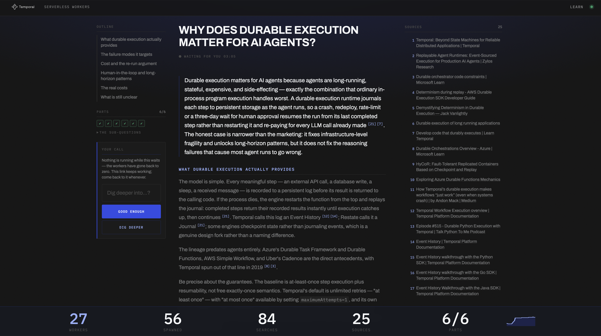
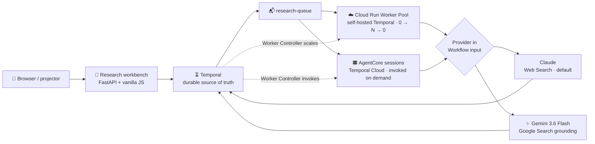
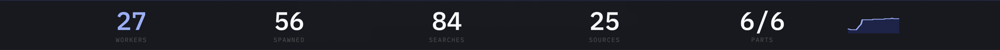
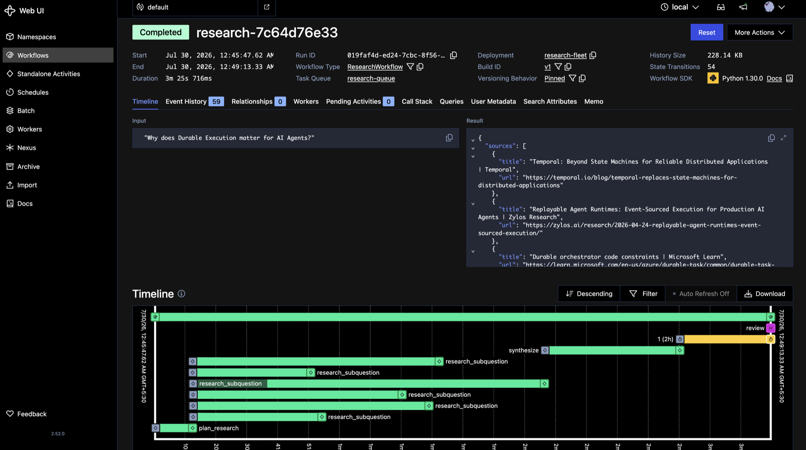
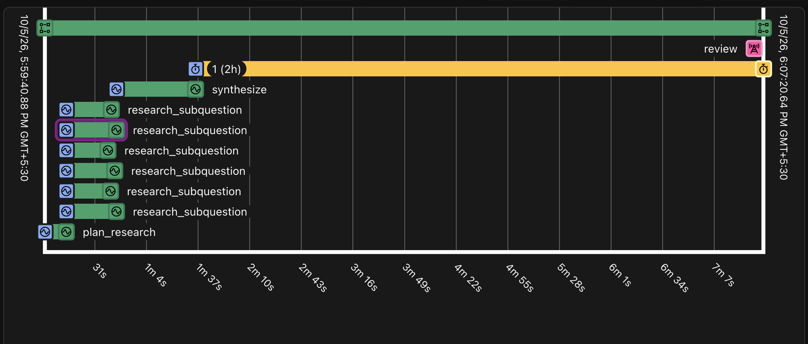
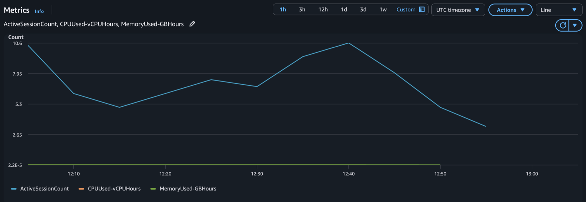
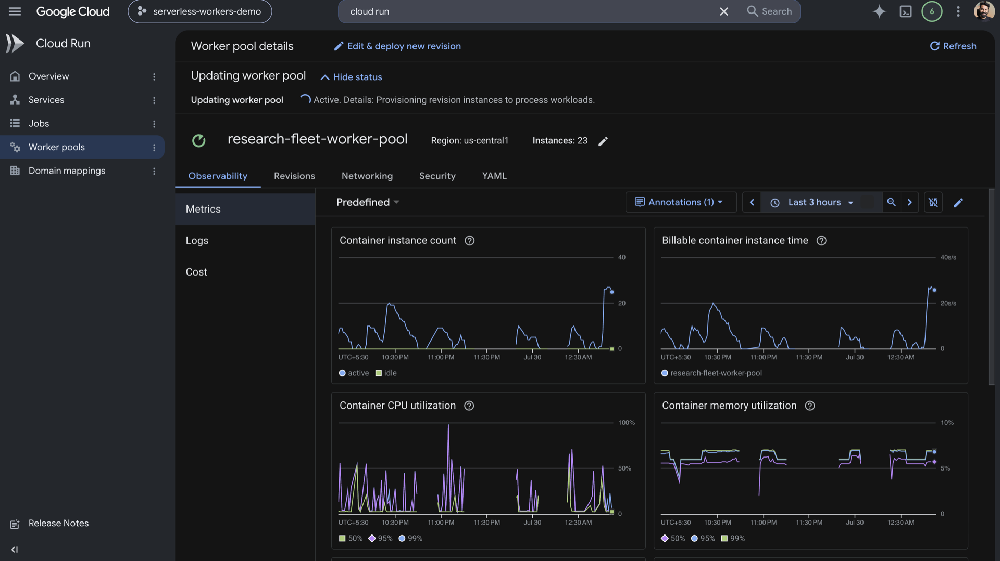
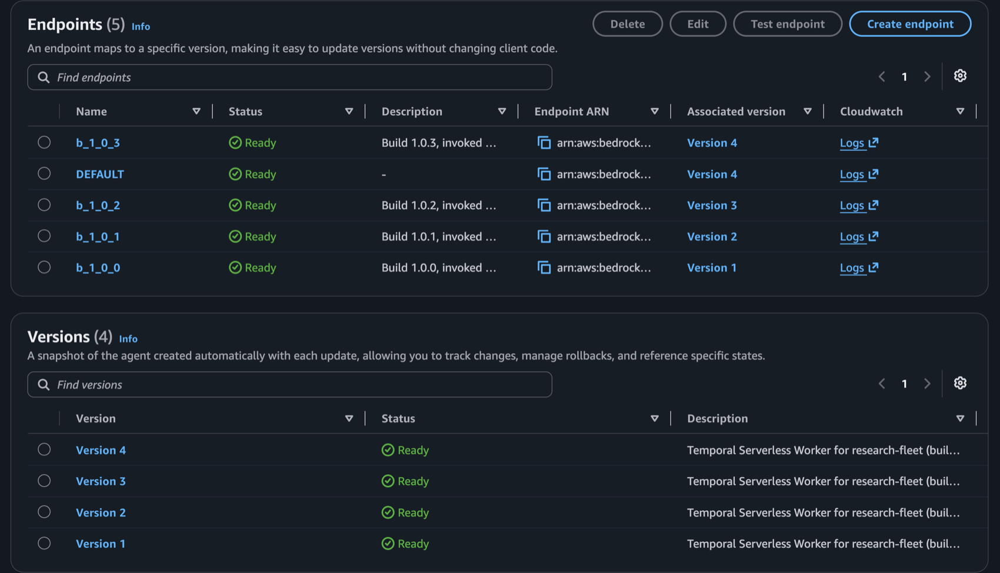

# Durable Research Fleet

<div align="center">

[](https://temporal.io)
[](https://cloud.google.com/run/docs/workerpools)
[](https://aws.amazon.com/bedrock/agentcore/)
[](#test-it)
[](LICENSE)

</div>

**Ask once. Watch a fleet appear, research in parallel, and disappear — while the Workflow stays alive.**

A conference-ready deep-research demo powered by **Temporal Serverless Workers**. The same Workflows and Activities run on two platforms: **Google Cloud Run** (self-hosted Temporal) or **Amazon Bedrock AgentCore Runtime** (Temporal Cloud). For each question the workbench lets you pick **Claude + Web Search** (the default) or **Gemini + Google Search**.

One question becomes several independent research jobs (3–6, decided by the planner). Temporal runs them in parallel on disposable compute that is created for the work and gone afterwards, and it preserves the plan, findings, report, and human-review pause throughout.

> **🎬 See the story:** ask from the workbench, watch Serverless Workers climb in the sticky footer, review the cited draft, then approve it after the fleet has returned to zero.



## 🧭 Choose your platform

Pick one per deployment. Everything above the compute layer is identical, and both platforms are **pre-release** on Temporal's side.

| | **Google Cloud Run** | **AWS AgentCore** |
|---|---|---|
| Where Temporal runs | Self-hosted on a GCP VM (unreleased CLI and server) | **Temporal Cloud**, AWS-hosted Namespace with the AgentCore pre-release enabled |
| Compute unit | A Cloud Run Worker Pool instance that polls until it is scaled away | An AgentCore **session** (a microVM, up to 8 hours) that polls until idle, then drains |
| How workers start | The Worker Controller sets the instance count | Temporal Cloud *invokes* a Runtime endpoint; Temporal decides how many sessions |
| Activity slots per Worker | `1` | `3` |
| Workers for a 5–6 way fan-out | Tracks the fan-out: one slot per instance | Fewer than sub-questions: 2–4 sessions seen |
| Hosted web tier | Cloud Run Service, internal-only | None; the console runs locally with `make web-cloud` |

**Pick Cloud Run** if you want the headline "one Worker per sub-question" picture on a projector and are comfortable self-hosting the pre-release Temporal server. **Pick AgentCore** if you already use Temporal Cloud on AWS and want no servers at rest; expect a smaller, less predictable worker count.

### 🎛 One CLI, either platform

The app is identical on both platforms; `--worker` only picks where the console and starter talk. Nothing is deployed or changed by switching.

```bash
cp fleet.toml.example fleet.toml          # per-developer config, gitignored, no secrets
./fleet targets                           # what each platform points at
./fleet doctor -w agentcore               # tools, keys, Temporal reachable, deployment exists
./fleet run -w agentcore                  # the console against Temporal Cloud
./fleet tunnel & ./fleet run -w cloudrun  # the console against the self-hosted VM
./fleet ask "How do heat pumps work?" -w agentcore -p gemini
./fleet status | verify | up | ship | down   # all take -w and --dry-run
./fleet use agentcore                     # make it the default
```

Ambient `TEMPORAL_*` variables are ignored on purpose, so a shell left on Temporal Cloud cannot redirect a Cloud Run command. `ship` encodes the sharp edges (retained build ids, the digest redeploy, no deploy while Workflows are running); `down` needs `--confirm <platform>`.

### ✨ Key demo moments

| Moment | What happens | Why it matters |
|---|---|---|
| 🔀 **Research fan-out** | One question becomes 3–6 independent sub-questions | Parallel work creates real Task Queue backlog |
| 🚀 **Workers from zero** | Cloud Run adds Workers, or AgentCore starts sessions, to meet that backlog | The fleet is created for the work, not kept warm |
| 🔎 **Grounded research** | Choose Claude + Web Search or Gemini + Google Search in the workbench | Findings return with sources instead of unsupported prose |
| ⏸️ **Durable review** | The Workflow parks with a finished draft and no active task | State survives without an app server or database holding the request open |
| ⚡ **Wake from zero** | Accept or refine sends a Temporal Signal | A live Workflow wakes even after every Worker has scaled away |

## 🏗 Why this architecture?

> **Traditional approach:** one long-running app process owns the request. If it dies mid-research, orchestration state and completed work need to be reconstructed.
>
> **This approach:** Temporal owns the durable execution. The Workers are disposable compute. A replacement Worker can continue from event history without rerunning sibling research that already finished.



A deployment uses one compute path at a time; the Workflows, Activities and provider seam are the same. There is no application database. The workbench is a projection of the Workflow's `progress` Query; the durable state lives in Temporal event history.

## The proof on screen

The outline sits on the left, the cited report in the middle, sources on the right, and live fleet counters along the bottom. When the draft is ready, `WAITING FOR YOU` appears with the review card.



Temporal shows the `research_subquestion` Activities overlapping, followed by synthesis and a timer ended early by the human-review Signal. This timeline is a six-wide Claude run; a Gemini run is usually narrower (see the note on fan-out width below):



The same view for a run on AgentCore (Claude, six sub-questions, served by three sessions). The long axis is the time the Workflow then waited for the reviewer, not compute; the review timer was ended early by the accept Signal:



AWS shows the same fleet as sessions. This is CloudWatch (`AWS/Bedrock-AgentCore`, `ActiveSessionCount`, times in UTC) across about an hour of repeated runs. AWS counts sessions, not polling Workers, and a session stays alive after its Worker drains until the idle timeout (15 minutes by default), so this line can read higher than the Worker count in the console footer and falls more slowly:



On Cloud Run, the console shows the same story from the infrastructure side:



## 5-minute local quickstart

The infrastructure path needs neither a cloud account nor a model key. You need Python 3 and the [Temporal CLI](https://docs.temporal.io/cli) (`brew install temporal` on macOS).

```bash
git clone https://github.com/temporal-community/durable-research-fleet.git
cd durable-research-fleet
python3 -m venv .venv
.venv/bin/pip install -r requirements-dev.txt
```

Run these in separate terminals:

```bash
# 1 — Temporal dev server; Web UI at http://localhost:8233
temporal server start-dev

# 2 — versioned local Worker
.venv/bin/python worker_local.py

# 3 — one-time, AFTER the Worker begins polling
temporal worker deployment set-current-version \
  --deployment-name research-fleet --build-id local --yes

# 4 — one Workflow, then a five-Workflow burst
.venv/bin/python starter.py --watch
.venv/bin/python starter.py --count 5 --watch
```

Step 3 is required: every Workflow declares a versioning behavior, so Temporal rejects its Workflow Tasks when the Worker is not in versioned mode.

### Run the research app

Put `ANTHROPIC_API_KEY` (Claude, the default) and/or `GEMINI_API_KEY` (from [Google AI Studio](https://aistudio.google.com/apikey)) in the gitignored `.env`. Either works alone. Then restart the Worker with local-only parallelism:

```bash
set -a; . ./.env; set +a
MAX_CONCURRENT_ACTIVITIES=6 .venv/bin/python worker_local.py
make web-local
```

Open **http://localhost:8000** and choose a provider next to the ask button. Claude is selected by default, so **if you only have a Gemini key, switch the dropdown to Gemini before your first question**; a Claude question without `ANTHROPIC_API_KEY` fails. The choice is recorded in Workflow input, so retries, review, and refinement stay on that provider even when both run in the same deployment.

One run uses one planning call, 3–6 grounded research calls, and one synthesis call. A refine decision may trigger one additional bounded fan-out.

The higher slot count is for local development only. Deployed, the value is set per platform: `1` on Cloud Run, where one Activity slot per instance is what turns the fan-out into a visible fleet, and `3` on AgentCore, where Temporal starts fewer sessions than sub-questions.

`MAX_SUBQUESTIONS` is a **ceiling, not a target.** The planner is asked for between
`MIN_SUBQUESTIONS` and `MAX_SUBQUESTIONS` sub-questions and the result is truncated to the
ceiling, never padded up to it — so the width, and therefore the Worker count on screen, is
whatever the model returned. Measured on the same question class with `MAX_SUBQUESTIONS=6`:
Claude returned 6, Gemini returned 4. If you need a specific number in front of a room, raise
`MIN_SUBQUESTIONS` in `research_activities.py` rather than trusting the planner to reach the top
of its range.

## Deploy: Google Cloud Run

> **Serverless Workers is Pre-release.** The Cloud Run provider is not in a released Temporal CLI/server. `make cli` builds the required main-branch CLI with the upstream Cloud Run field-mask fix pinned in, and Terraform ships it to the VM.

### What you need

A GCP project, `gcloud`, Docker, Terraform, and a model key: `ANTHROPIC_API_KEY` for the Claude default, `GEMINI_API_KEY` for Gemini, or both (with only a Gemini key, switch the dropdown to Gemini). `PROJECT` must be set explicitly unless you own the repository's default demo project.

### Deploy

```bash
export ANTHROPIC_API_KEY=your-key   # Claude, the default
export GEMINI_API_KEY=your-key      # optional: Gemini

make up AUTO=1 PROJECT=your-project-id
make register-queues PROJECT=your-project-id
make verify SCALE=1 PROJECT=your-project-id
```

That sequence builds the unreleased Temporal CLI, creates the GCP stack, seeds Secret Manager without putting the keys in Terraform state, registers the Task Queues, and proves scale-from-zero.

### Open the console

The Cloud Run web Service is intentionally **internal-only**, so its `run.app` URL fails from a public browser; that is the security boundary, not a broken deployment. Serve the workbench locally against the deployed fleet:

```bash
make tunnel PROJECT=your-project-id   # terminal 1, leave running
make web-local                        # terminal 2
```

Then open **http://localhost:8000**. Port overrides, SSH troubleshooting and redeploying new code are in [docs/CLOUDRUN.md](docs/CLOUDRUN.md).

### Shape of the deployment

| Layer | GCP resource | Behavior |
|---|---|---|
| Temporal | Compute Engine VM | Private frontend at `10.10.0.10:7233`; runs the pre-release Worker Controller |
| Research fleet | Cloud Run Worker Pool | Manual count controlled by Temporal; normally zero when idle |
| Web tier | Cloud Run Service | Internal ingress and authenticated invocation only |
| Model keys | Secret Manager | Both refs mount into Workers; values never pass through Terraform state |
| Worker image | Artifact Registry | One image with Worker and web entrypoints |

### Measured

Live check on August 18, 2026: 16/16 deployment checks passed. Five queued smoke-test Workflows took the Worker Pool from **zero to its first instance in 20 seconds**, peaking at 6; the smoke test uses no model tokens. A real Gemini run completed plan → 4-way fan-out → synthesis → review → accept in **74 seconds**. These are single runs. The earlier Cloud Run Claude figures in [AGENTS.md](AGENTS.md) (52 searches, 713,758 tokens) predate the four-search cap, so they are not comparable to the AgentCore numbers below.

### Known limits

The CLI and server it needs are unreleased, so a fresh checkout depends on `make cli`, and the web tier is reachable only through the tunnel by design. Details: [docs/CLOUDRUN.md](docs/CLOUDRUN.md).

## Deploy: AWS AgentCore

The same Workflows and Activities run as Temporal Serverless Workers on **Amazon Bedrock AgentCore Runtime**. Temporal Cloud *invokes* a Runtime endpoint when a Task Queue has a backlog; each invocation starts a session (a microVM, up to 8 hours) that polls until it has been idle, then drains. Nothing runs at rest. [docs/AGENTCORE.md](docs/AGENTCORE.md) has the full design, the decisions behind it, and the verified / unverified lists.

> **Pre-release.** AgentCore as a Serverless Workers compute provider is a Temporal pre-release, and you cannot try it without access to it on your Namespace.

### What you need

| Need | Notes |
|---|---|
| **Temporal Cloud Namespace, AWS-hosted** | With the **AgentCore Serverless Workers pre-release** enabled (ask your account team or open a support ticket). Self-hosted Temporal is not covered |
| **A Temporal Cloud API key** | Ideally a service-account key scoped to this one Namespace |
| **AWS account and credentials** | Permission for AgentCore, IAM, S3, Secrets Manager. Use a named profile: `AWS_PROFILE=...` |
| **Region** | An AgentCore-supported Region, ideally next to your Namespace (default `ca-central-1`) |
| **Temporal CLI ≥ 1.8.3** | For `temporal worker deployment create-version --aws-agentcore-*` |
| **Terraform ≥ 1.9 and `uv`** | `uv` builds the arm64 Runtime zip for Python 3.12; no local Python 3.12 is needed |
| **A model key** | `ANTHROPIC_API_KEY` for the Claude default, `GEMINI_API_KEY` for Gemini. Either works alone; with only a Gemini key, switch the dropdown to Gemini |

### Deploy

Create `agentcore/terraform.tfvars` (gitignored) and fill `.env` from `.env.example` with `TEMPORAL_API_KEY` and your model key(s):

```hcl
temporal_namespace = "<name>.<account-id>"
temporal_address   = "<name>.<account-id>.tmprl.cloud:7233"
build_id           = "1.0.0"
```

```bash
export AWS_PROFILE=your-profile
make ac-plan                    # read-only; review it
make ac-apply                   # Runtime, endpoint, IAM, S3, Secrets Manager
make ac-secrets                 # seed Secrets Manager from .env (never touches Terraform state)
SET_CURRENT=1 make ac-register  # register the Version with Temporal Cloud and route to it
make ac-verify                  # real Workflows through real invocations; spends no model tokens
```

The one rule to remember: any change to the Runtime, code **or** an environment variable, needs a **new `build_id`** with the previous one added to `retained_build_ids`. `agentcore/guard.sh` refuses an apply that forgets. The full upgrade procedure is in [docs/AGENTCORE.md](docs/AGENTCORE.md).

### Open the console

There is no hosted web tier. Serve the workbench locally against your Namespace, then open **http://localhost:8000**:

```bash
make web-cloud
```

### Shape of the deployment

| Layer | AWS / Temporal resource | Behavior |
|---|---|---|
| Temporal | Temporal Cloud, AWS-hosted Namespace | Holds all state; its Worker Controller invokes the endpoint |
| Research fleet | AgentCore Runtime sessions | One endpoint per Build ID; sessions start on demand and drain when idle |
| Code | S3 bucket, arm64 zip | Content-hashed key; published zips are never deleted |
| Model and Temporal keys | Secrets Manager | The Runtime holds ARNs; sessions fetch values at start |
| Access | Two IAM roles | Execution role for the Worker; invocation role for Temporal, gated by an ExternalId |

In the Bedrock AgentCore console, each Build ID has its own endpoint pinned to its own Runtime version: `b_1_0_0` to Version 1, `b_1_0_1` to Version 2, and so on. None moved when newer versions were published, which is what keeps a Workflow parked on an old build running the code it started on. The `DEFAULT` endpoint currently points at the newest version (4); Temporal is registered against the named endpoints, not `DEFAULT`.



### Measured

Live check on October 5, 2026, on a Namespace in `ca-central-1`: five hello Workflows with no Worker running completed in **35 seconds** through real invocations, and the research app finished with Claude and with Gemini, 0 failures. One Claude question, before and after tuning:

| | Untuned (`1.0.2`) | Tuned (`1.0.3`) |
|---|---|---|
| Plan to synthesis | 276s | **96s** |
| Web searches / tokens | 66 / 546,837 | 24 / 304,374 |

The tuning is a four-search cap (prompt and tool), Sonnet for the narrow sub-questions with Opus kept for synthesis, and three Activity slots per session. It is one question on one setup; the answer cited more first-party sources but was thinner on pricing detail. Compare a few of your own before trusting it. AgentCore started 2–4 sessions for 5–6 sub-questions, so the Worker count on a projector will be lower and less predictable than on Cloud Run.

### Known limits

Not proven yet: what happens when AgentCore stops a session in the middle of an Activity, whether warm sessions are really reused, and how Temporal chooses the session count. There is no hosted web tier, no Amazon Bedrock model provider (research calls Anthropic and Google by API key), local Terraform state, and no alarms or CI. The full list is in [docs/AGENTCORE.md](docs/AGENTCORE.md).

## Cost and cleanup

Both stacks create billable resources, and every research question spends model tokens: about 30k with Gemini and 300k or more with Claude in our runs (Claude tuned 304,374; untuned 546,837).

- **Cloud Run** keeps a Compute Engine VM running for Temporal. The Worker Pool itself is zero when idle. Tear down with `make down PROJECT=your-project-id` (a partial teardown is normal; see [docs/CLOUDRUN.md](docs/CLOUDRUN.md)).
- **AgentCore** keeps no compute at rest, and Temporal Cloud usage is billed by Temporal. Tear down the AWS side with `AWS_PROFILE=your-profile make ac-down`. That deletes the code bucket and its zips, schedules the three secrets for deletion (their names stay reserved for the recovery window, 7 days by default; set `secret_recovery_window_days = 0` for a throwaway stack), and leaves the Worker Deployment in Temporal Cloud, which you remove yourself with `temporal worker deployment unset-current-version --deployment-name research-fleet-agentcore`.

## How the Workflow runs

```text
plan → fan out research → synthesize → wait for review → accept or refine
```

- `HelloWorkflow` is the token-free infrastructure smoke test. Its five-second Activity creates the backlog used to verify scaling.
- `ResearchWorkflow` is the real application. It plans, fans out, synthesizes, pauses for review, and optionally performs one refinement round.
- `apps.py` is the one list of Workflows and Activities. The local, Cloud Run and AgentCore Workers all register from it.
- `runtime.py` is app-agnostic infrastructure. Both applications plug into its versioned Worker seam, on either platform.
- `llm.py` is the dual-provider seam. Temporal is the only Activity retry layer; both search tools run server-side.
- Provider selection is per Workflow, not an environment switch. Gemini's grounded call is atomic; Claude additionally preserves its `pause_turn` / `_resume_from` continuation path, ephemeral cache marker, and `MAX_PAUSE_RESUMES` bound.

## Configuration

Local defaults target `temporal server start-dev`. The "Deployed" column shows what each platform's stack sets.

| Variable | Default | Deployed (Cloud Run / AgentCore) | Purpose |
|---|---|---|---|
| `TEMPORAL_ADDRESS` | `localhost:7233` | VM address / `<ns>.tmprl.cloud:7233` | Temporal frontend address |
| `TEMPORAL_API_KEY` | unset | unset / Secrets Manager | Temporal Cloud credential; setting it enables TLS |
| `TEMPORAL_DEPLOYMENT_NAME` | `research-fleet` | `research-fleet` / `research-fleet-agentcore` | Versioned Worker Deployment name |
| `MAX_CONCURRENT_ACTIVITIES` | `1` | `1` / `3` | Activity slots per Worker. Raising it on Cloud Run hides the scaling |
| `MAX_SUBQUESTIONS` | `6` | same | Fan-out **ceiling**; the planner may return fewer, so the Worker count varies by provider |
| `RESEARCH_EFFORT` | `medium` | same | Provider effort / thinking level |
| `GEMINI_MODEL` | `gemini-3.6-flash` | same | Model selected without rebuilding |
| `GEMINI_API_KEY` | unset | Secret Manager / Secrets Manager | Required only when a research Activity first calls Gemini |
| `ANTHROPIC_MODEL` | `claude-opus-5` | same | Claude model for planning and synthesis |
| `ANTHROPIC_API_KEY` | unset | Secret Manager / Secrets Manager | Required only when the selection is Claude (the default) |
| `ANTHROPIC_RESEARCH_MODEL` | unset | unset / `claude-sonnet-5-5` | Claude model for the research sub-questions only |
| `CLAUDE_MAX_SEARCHES` | `4` | same | Web searches per Claude request (`0` = uncapped); the research prompt states the same budget |
| `AGENTCORE_DEBOUNCE_SECONDS` | `60` | n/a / `60` (Terraform default) | AgentCore: how long a Worker polls after its last Activity before draining; raise it to keep sessions warm |
| `<NAME>_SECRET_ARN` | unset | n/a / set | AgentCore: Secrets Manager ARN resolved at session start for `TEMPORAL_API_KEY`, `GEMINI_API_KEY`, `ANTHROPIC_API_KEY` |
| `DEMO_PASSCODE` | unset | same | Guards both asking and refinement actions in the web tier |

## Test it

```bash
make test
```

The suite is offline: **152 Python tests** plus Terraform contract tests for both stacks
(`make test-tf` for GCP, `make test-ac` for AgentCore). Both provider clients use fakes and tests never spend tokens.

For the live infrastructure gates:

```bash
make verify SCALE=1 PROJECT=your-project-id    # Cloud Run
AWS_PROFILE=your-profile make ac-verify        # AgentCore
```

## Repository map

| Path | Role |
|---|---|
| `runtime.py` | Connection, versioned Worker, slot limits, unique identity, graceful shutdown |
| `workflows.py` · `activities.py` | Token-free infrastructure smoke test |
| `apps.py` | The one list of Workflows and Activities every Worker registers |
| `worker_local.py` · `worker_cloudrun.py` | Local and Cloud Run entrypoints |
| `agentcore_runtime.py` · `worker_agentcore.py` | AgentCore session lifecycle (start, idle-drain, release) and its app binding |
| `llm.py` | Gemini/Claude provider boundary, isolated from Temporal |
| `research_*.py` | Plan, parallel research, synthesis, review, and transport types |
| `web.py` · `web/` | Responsive workbench; FastAPI and vanilla JS, no build step |
| `terraform/` | Complete private GCP stack |
| `agentcore/` | AWS stack for AgentCore + Temporal Cloud: Terraform, arm64 build, secrets, registration, live verify |
| `tests/` | Workflow, replay, web-security, provider, and infrastructure contracts |
| `learn/` · `docs/` | In-app learning cards, tutorial, knowledge base, and the per-platform operating notes |

Per-platform operating notes: [docs/CLOUDRUN.md](docs/CLOUDRUN.md) and [docs/AGENTCORE.md](docs/AGENTCORE.md). For the manual Cloud Run walkthrough, see [docs/TUTORIAL.md](docs/TUTORIAL.md). For the platform research and design rationale, see [docs/KNOWLEDGE_BASE.md](docs/KNOWLEDGE_BASE.md).

## License

Apache-2.0 — see [LICENSE](LICENSE). Copyright 2026 Temporal Technologies, Inc.

Bundled fonts are redistributed under the SIL Open Font License (`web/fonts/LICENSE-*.txt`). The Temporal wordmark in `web/temporal-logo.svg` is a trademark of Temporal Technologies, included for this demo and not covered by Apache-2.0.

---

Built from the original [Durable Research Fleet](https://github.com/temporal-community/durable-research-fleet), created by [Shubham Londhe (@LondheShubham153)](https://github.com/LondheShubham153).
