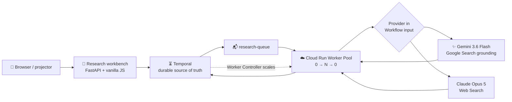

# Durable Research Fleet

<div align="center">

[](https://temporal.io)
[](https://cloud.google.com/run/docs/workerpools)
[](https://googleapis.github.io/python-genai/)
[](https://ai.google.dev/gemini-api/docs)
[](https://docs.anthropic.com/)
[](#test-it)
[](LICENSE)

</div>

**Ask once. Watch a fleet appear, research in parallel, and disappear — while the Workflow stays alive.**

A conference-ready deep-research demo powered by **Temporal Serverless Workers**, runnable two ways: on **Google Cloud Run** (self-hosted Temporal) or on **Amazon Bedrock AgentCore Runtime** (Temporal Cloud). **Claude + Web Search** is the UI default on this branch and **Gemini + Google Search** is available per request.

One question becomes several independent research jobs (3–6, decided by the planner). Each job maps to one Cloud Run Worker, the pool scales `0 → N → 0`, and Temporal preserves the plan, findings, report, and human-review pause throughout.

> **🎬 See the story:** ask from the workbench, watch Serverless Workers climb in the sticky footer, review the cited draft, then approve it after the pool has returned to zero.


### ✨ Key demo moments

| Moment | What happens | Why it matters |
|---|---|---|
| 🔀 **Research fan-out** | One question becomes 3–6 independent sub-questions | Parallel work creates real Task Queue backlog |
| 🚀 **Workers from zero** | Cloud Run adds one-slot Workers to meet that backlog | The fleet is created for the work, not kept warm |
| 🔎 **Grounded research** | Choose Gemini + Google Search or Claude + Web Search in the workbench | Findings return with sources instead of unsupported prose |
| ⏸️ **Durable review** | The Workflow parks with a finished draft and no active task | State survives without an app server or database holding the request open |
| ⚡ **Wake from zero** | Accept or refine sends a Temporal Signal | A live Workflow wakes even after the Worker Pool has scaled away |

> **Last live infrastructure verification — August 18, 2026:** 16/16 deployment checks passed. Five queued smoke-test Workflows took the Worker Pool from **zero to its first instance in 20 seconds**, peaking at 6 while the backlog drained. The smoke test uses no model tokens. A real Gemini run on the same deployment completed plan → 4-way fan-out → synthesis → review → accept in **74 seconds**.

## 🏗 Why this architecture?

> **Traditional approach:** one long-running app process owns the request. If it dies mid-research, orchestration state and completed work need to be reconstructed.
>
> **This approach:** Temporal owns the durable execution. Cloud Run Workers are disposable compute. A replacement Worker can continue from event history without rerunning sibling research that already finished.



There is no application database. The workbench is a projection of the Workflow's `progress` Query; the durable state lives in Temporal event history.

## The proof on screen

The outline sits on the left, the cited report in the middle, sources on the right, and live fleet counters along the bottom. When the draft is ready, `WAITING FOR YOU` appears with the review card.


Temporal shows the `research_subquestion` Activities overlapping, followed by synthesis and a timer ended early by the human-review Signal. This timeline is a six-wide Claude run; a Gemini run is usually narrower (see the note on fan-out width below):


Cloud Run shows the same story from the infrastructure side:


## 5-minute local quickstart

The infrastructure path needs neither GCP nor a model key.

```bash
git clone https://github.com/temporal-community/durable-research-fleet.git
cd durable-research-fleet
python3 -m venv .venv
.venv/bin/pip install -r requirements-dev.txt
```

Run these in separate terminals:

```bash
# 1 — Temporal dev server; Web UI at http://localhost:8233
temporal server start-dev

# 2 — versioned local Worker
.venv/bin/python worker_local.py

# 3 — one-time, AFTER the Worker begins polling
temporal worker deployment set-current-version \
  --deployment-name research-fleet --build-id local --yes

# 4 — one Workflow, then a five-Workflow burst
.venv/bin/python starter.py --watch
.venv/bin/python starter.py --count 5 --watch
```

Step 3 is required: every Workflow declares a versioning behavior, so Temporal rejects its Workflow Tasks when the Worker is not in versioned mode.

### Run the research app

Create a `GEMINI_API_KEY` in [Google AI Studio](https://aistudio.google.com/apikey) and place it in the gitignored `.env`. Add `ANTHROPIC_API_KEY` only if you also want the Claude option. Then restart the Worker with local-only parallelism:

```bash
set -a; . ./.env; set +a
MAX_CONCURRENT_ACTIVITIES=6 .venv/bin/python worker_local.py
make web-local
```

Open **http://localhost:8000** and choose a provider next to the ask button. Gemini is selected by default. The choice is recorded in Workflow input, so retries, review, and refinement stay on that provider even when both modes run in the same deployment.

One run uses one planning call, 3–6 grounded research calls, and one synthesis call. A refine decision may trigger one additional bounded fan-out.

The higher slot count is only for local development. Keep the deployed value at `1`: one Activity slot per instance is what turns the fan-out into a visible Serverless Worker fleet.

`MAX_SUBQUESTIONS` is a **ceiling, not a target.** The planner is asked for between
`MIN_SUBQUESTIONS` and `MAX_SUBQUESTIONS` sub-questions and the result is truncated to the
ceiling, never padded up to it — so the width, and therefore the Worker count on screen, is
whatever the model returned. Measured on the same question class with `MAX_SUBQUESTIONS=6`:
Claude returned 6, Gemini returned 4. If you need a specific number in front of a room, raise
`MIN_SUBQUESTIONS` in `research_activities.py` rather than trusting the planner to reach the top
of its range.

## Deploy to GCP

You need a GCP project, `gcloud`, Docker, Terraform, and a Gemini key. An Anthropic key is optional. `PROJECT` must be set explicitly unless you own the repository's default demo project.

```bash
export GEMINI_API_KEY=your-key
# Optional: enables the Claude choice in the same workbench
# export ANTHROPIC_API_KEY=your-key

make up AUTO=1 PROJECT=your-project-id
make register-queues PROJECT=your-project-id
make verify SCALE=1 PROJECT=your-project-id
```

That sequence builds the unreleased Temporal CLI needed for the Cloud Run provider, creates the GCP stack, seeds Secret Manager without putting the key in Terraform state, registers the Task Queues, and proves scale-from-zero.

> **Serverless Workers is Pre-release.** The Cloud Run provider is not in a released Temporal CLI/server. `make cli` builds the required main-branch CLI with the upstream Cloud Run field-mask fix pinned in, and Terraform ships it to the VM.

### Open the deployed workbench

The Cloud Run web Service is intentionally **internal-only**. Opening its `run.app` URL from a public browser should fail; that is the security boundary, not a broken deployment.

Serve the same workbench locally while it drives the real deployed Temporal and Cloud Run fleet:

```bash
# Terminal 1 — leave running
make tunnel PROJECT=your-project-id

# Terminal 2
make web-local
```

Then open **http://localhost:8000**. Both tunnels auto-reconnect, so a VPN
re-handshake or a laptop sleeping costs about five seconds instead of the run.

Every local port is overridable, which matters if you already have a Temporal dev
server or another app running. `web-local` follows `LOCAL_FRONTEND_PORT`, so pass
the same value to both and nothing else needs setting:

```bash
make tunnel PROJECT=your-project-id LOCAL_FRONTEND_PORT=7433
make web-local LOCAL_FRONTEND_PORT=7433 WEB_PORT=8100
```

If SSH times out rather than refusing, the SSH firewall rule is pinned to a public
IP you no longer have — see `ssh_source_ranges` in `terraform/variables.tf`.

The deployed shape is:

| Layer | GCP resource | Behavior |
|---|---|---|
| Temporal | Compute Engine VM | Private frontend at `10.10.0.10:7233`; runs the prerelease Worker Controller |
| Research fleet | Cloud Run Worker Pool | Manual count controlled by Temporal; normally zero when idle |
| Web tier | Cloud Run Service | Internal ingress and authenticated invocation only |
| Model keys | Secret Manager | Both refs mount into Workers; values never pass through Terraform state |
| Worker image | Artifact Registry | One image with Worker and web entrypoints |

After rebuilding the image with the same tag, force the Worker Pool onto the new digest; Cloud Run pins image digests per revision. See [AGENTS.md](AGENTS.md) gate #14 for the exact command and the other deployment invariants.

## Deploy to AWS (Bedrock AgentCore + Temporal Cloud)

The same Workflows and Activities run as Temporal Serverless Workers on **Amazon Bedrock AgentCore Runtime**. Temporal Cloud *invokes* a Runtime endpoint when a Task Queue has a backlog; each invocation starts a session (a microVM, up to 8 hours) that polls until it has been idle, then drains. Nothing runs at rest. The full design, decisions and what is and isn't proven live are in **[docs/AGENTCORE.md](docs/AGENTCORE.md)**.

> **Pre-release.** AgentCore as a Serverless Workers compute provider is a Temporal pre-release. Verified live on a Temporal Cloud Namespace in `ca-central-1`, for both the hello smoke test and the research app (Gemini and Claude). Treat the "Verified" and "Still unverified" lists in the docs as the source of truth.

### What you need

| Need | Notes |
|---|---|
| **Temporal Cloud Namespace, AWS-hosted** | With the **AgentCore Serverless Workers pre-release** enabled (ask your account team or open a support ticket). Self-hosted Temporal is not covered |
| **A Temporal Cloud API key** | Ideally a service-account key scoped to this one Namespace |
| **AWS account and credentials** | Permission for AgentCore, IAM, S3, Secrets Manager. Use a named profile: `AWS_PROFILE=...` |
| **Region** | An AgentCore-supported Region, ideally next to your Namespace (default `ca-central-1`) |
| **Temporal CLI ≥ 1.8.3** | For `temporal worker deployment create-version --aws-agentcore-*` |
| **Terraform ≥ 1.9, `uv`, Python 3.12+** | `uv` builds the arm64 Runtime zip |
| **A model key** | `ANTHROPIC_API_KEY` for the Claude default, `GEMINI_API_KEY` for Gemini. Either works alone |

### Deploy

```bash
cp .env.example .env            # add TEMPORAL_API_KEY and your model key(s)
# agentcore/terraform.tfvars (gitignored):
#   temporal_namespace = "<name>.<account-id>"
#   temporal_address   = "<name>.<account-id>.tmprl.cloud:7233"
#   build_id           = "1.0.0"

export AWS_PROFILE=your-profile
make ac-plan                    # read-only; review it
make ac-apply                   # Runtime, endpoint, IAM, S3, Secrets Manager
make ac-secrets                 # seed Secrets Manager from .env (never touches Terraform state)
SET_CURRENT=1 make ac-register  # register the Version with Temporal Cloud and route to it
make ac-verify                  # real Workflows through real invocations; spends no model tokens
make web-cloud                  # the console, against your Namespace
```

Any change to the Runtime (code **or** an environment variable) needs a **new `build_id`**, with the previous one added to `retained_build_ids`, because each Build ID is pinned to one immutable Runtime version. `agentcore/guard.sh` refuses an apply that forgets this. Details in the docs.

### Measured on AgentCore (Claude, one question, `1.0.3`)

| | Untuned (`1.0.2`) | Tuned (`1.0.3`) |
|---|---|---|
| Plan to synthesis | 276s | **96s** |
| Web searches / tokens | 66 / 546,837 | 24 / 304,374 |

The tuning is a four-search cap (prompt and tool), Sonnet for the narrow sub-questions with Opus kept for synthesis, and three Activity slots per session. It is one question on one setup; the answer cited more first-party sources but was thinner on pricing detail. Compare a few of your own before trusting it. AgentCore started 2–4 sessions for 5–6 sub-questions, so the Worker count on a projector will be lower and less predictable than on Cloud Run.

### What this stack does not do

No hosted web tier (the console runs locally via `make web-cloud`), no Amazon Bedrock model provider (research calls Anthropic and Google by API key), local Terraform state, and no alarms or CI. See the docs for the full list.

## How the Workflow runs

```text
plan → fan out research → synthesize → wait for review → accept or refine
```

- `HelloWorkflow` is the token-free infrastructure smoke test. Its five-second Activity creates the backlog used to verify scaling.
- `ResearchWorkflow` is the real application. It plans, fans out, synthesizes, pauses for review, and optionally performs one refinement round.
- `runtime.py` is app-agnostic infrastructure. Both applications plug into its versioned Worker seam.
- `llm.py` is the dual-provider seam. Temporal is the only Activity retry layer; both search tools run server-side.
- Provider selection is per Workflow, not an environment switch. Gemini's grounded call is atomic; Claude additionally preserves its `pause_turn` / `_resume_from` continuation path, ephemeral cache marker, and `MAX_PAUSE_RESUMES` bound.

## Configuration

Local defaults target `temporal server start-dev`.

| Variable | Default | Purpose |
|---|---|---|
| `TEMPORAL_ADDRESS` | `localhost:7233` | Temporal frontend address |
| `TEMPORAL_API_KEY` | unset | Temporal Cloud credential; setting it enables TLS |
| `TEMPORAL_DEPLOYMENT_NAME` | `research-fleet` | Versioned Worker Deployment name |
| `MAX_CONCURRENT_ACTIVITIES` | `1` | Activity slots per Worker. Keep `1` on Cloud Run (raising it hides scaling); AgentCore is deployed with `3` |
| `MAX_SUBQUESTIONS` | `6` | Fan-out **ceiling**; the planner may return fewer, so the Worker count varies by provider |
| `RESEARCH_EFFORT` | `medium` | Provider effort / thinking level |
| `GEMINI_MODEL` | `gemini-3.6-flash` | Model selected without rebuilding the image |
| `GEMINI_API_KEY` | unset | Required only when a research Activity first calls Gemini |
| `ANTHROPIC_MODEL` | `claude-opus-5` | Claude model selected without rebuilding the image |
| `ANTHROPIC_API_KEY` | unset | Required only when the UI selection is Claude |
| `ANTHROPIC_RESEARCH_MODEL` | unset | Claude model for the research sub-questions only; AgentCore deploys `claude-sonnet-5-5` |
| `CLAUDE_MAX_SEARCHES` | `4` | Web searches per Claude request (`0` = uncapped); the research prompt states the same budget |
| `AGENTCORE_DEBOUNCE_SECONDS` | `60` | AgentCore: how long a Worker polls after its last Activity before draining |
| `<NAME>_SECRET_ARN` | unset | AgentCore: Secrets Manager ARN resolved at session start for `TEMPORAL_API_KEY`, `GEMINI_API_KEY`, `ANTHROPIC_API_KEY` |
| `DEMO_PASSCODE` | unset | Guards both asking and refinement actions in the web tier |

## Test it

```bash
make test
```

The suite is offline: **152 Python tests** plus Terraform contract tests for both stacks
(`make test-tf`, `make test-ac`). Both provider clients use fakes and tests never spend tokens.

For the live infrastructure gate:

```bash
make verify SCALE=1 PROJECT=your-project-id
```

## Repository map

| Path | Role |
|---|---|
| `runtime.py` | Connection, versioned Worker, slot limits, unique identity, graceful shutdown |
| `workflows.py` · `activities.py` | Token-free infrastructure smoke test |
| `apps.py` | The one list of Workflows and Activities every Worker registers |
| `agentcore_runtime.py` · `worker_agentcore.py` | AgentCore session lifecycle (start, idle-drain, release) and its app binding |
| `llm.py` | Gemini/Claude provider boundary, isolated from Temporal |
| `research_*.py` | Plan, parallel research, synthesis, review, and transport types |
| `web.py` · `web/` | Responsive workbench; FastAPI and vanilla JS, no build step |
| `terraform/` | Complete private GCP stack |
| `agentcore/` | AWS stack for AgentCore + Temporal Cloud: Terraform, arm64 build, secrets, registration, live verify |
| `tests/` | Workflow, replay, web-security, provider, and infrastructure contracts |
| `learn/` · `docs/` | In-app learning cards, runnable tutorial, and research knowledge base |

For the manual walkthrough, see [docs/TUTORIAL.md](docs/TUTORIAL.md). For the platform research and design rationale, see [docs/KNOWLEDGE_BASE.md](docs/KNOWLEDGE_BASE.md).

## License

Apache-2.0 — see [LICENSE](LICENSE). Copyright 2026 Temporal Technologies, Inc.

Bundled fonts are redistributed under the SIL Open Font License (`web/fonts/LICENSE-*.txt`). The Temporal wordmark in `web/temporal-logo.svg` is a trademark of Temporal Technologies, included for this demo and not covered by Apache-2.0.

---

Built from the original [Durable Research Fleet](https://github.com/temporal-community/durable-research-fleet), created by [Shubham Londhe (@LondheShubham153)](https://github.com/LondheShubham153).
